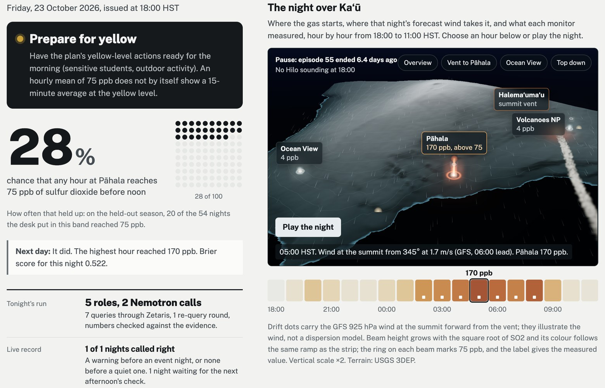
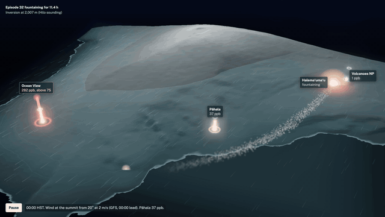
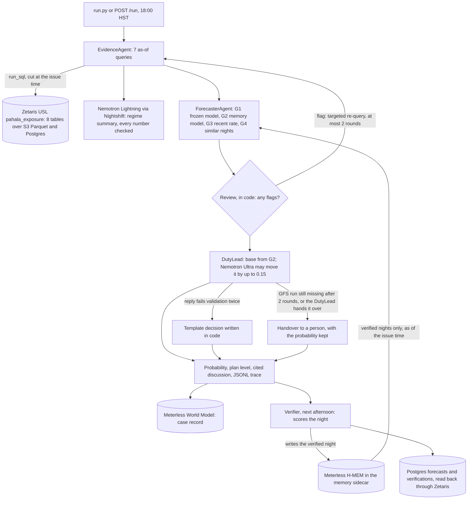

# vog-desk

- Demo video, 3 min 54 s: https://youtu.be/EGJ8WhEMQvc
- Live page, with every night the desk has issued: https://zeyusuntt.github.io/vog-desk/web/
- Replay of 2 September 2025, the night Pāhala reached 317 ppb: https://zeyusuntt.github.io/vog-desk/web/?replay=2025-09-02
- Slide deck: [docs/vog-desk-deck.pdf](docs/vog-desk-deck.pdf)

On the held-out season (1 July to 21 October 2026, 102 nights, pre-registered and scored once) the desk's Brier score was 0.215, against 0.332 for the model frozen on 2025, 0.246 for the recent-rate baseline and 0.236 for a constant at the season's own rate, which nobody knew in advance. It ran live from 23 to 26 October 2026: a forecast every evening at 18:00, each committed before the outcome and checked against the monitor the next afternoon. `scripts/prove.py` re-checks every one of these numbers, and the commit times, from the committed files.

A forecast desk for volcanic smog (vog) at Pāhala, Hawaiʻi Island. Every evening at 18:00 HST it gives a calibrated probability that some hour at the Pāhala monitor reaches 75 ppb of sulfur dioxide before noon the next day, a recommendation that follows the 2018 Hawaiʻi Schools SO2 Action Plan, and a discussion in which every number points at the evidence it came from. The next day it checks itself against the monitor and remembers the night.

Built for the Open Agent Hackathon 2026 (GenAI Works), Track 3, Reasoning Architecture, by a team of one. Work in this repository started inside the build window (22 October 2026, 00:00 UTC). The development log, with the numbers behind each decision, is [docs/DEVLOG.md](docs/DEVLOG.md); the held-out results, scored once at the end, are in [docs/RESULTS.md](docs/RESULTS.md).



The page a school's designated person reads at 18:00 ([web/](web/README.md)). It leads with the decision in the schools plan's colour, then the probability as a number and as 100 nights, with how often nights in that band reached 75 ppb on the held-out season. Beside it is the night over Kaʻū: the summit vent, the three monitors, the forecast wind and the inversion from the Hilo sounding, and after the night is verified each measured hour rises as a beam with a ring at 75 ppb. Drag to turn it, pick a viewpoint, click a monitor for its night, or play the eighteen hours. Below are the five roles of the desk and what each did that night, the discussion with every number tied to its evidence, the trace step by step, and the held-out record. `?replay=2025-09-02` replays the night Pāhala reached 317 ppb.



## Two minutes for judges

| Open | What you should see | Criterion |
|---|---|---|
| [Live page, first live night](https://zeyusuntt.github.io/vog-desk/web/?night=2026-10-23) | 28%, prepare for yellow; the next day Pāhala reached 170 ppb at 05:00 | Impact, Product and UX |
| [Replay of 2 September 2025](https://zeyusuntt.github.io/vog-desk/web/?replay=2025-09-02) | the night Pāhala reached 317 ppb, hour by hour on the map | Demo |
| `.venv/bin/python scripts/prove.py` | PASS for every headline number and the commit timeline | Technical |
| `SAMPLE_MODE=true .venv/bin/python run.py --issue 2026-05-07` | the full desk on a recorded night, no keys or services | Technical |
| [live/2026-10-25/trace.jsonl](live/2026-10-25/trace.jsonl) | each step: Zetaris queries, the review's re-queries, the model that answered each call, validation | Technical, Sponsor |
| [docs/RESULTS.md](docs/RESULTS.md) | held-out scores with intervals, reliability, value | Innovation, Technical |
| [Sponsor technology](#sponsor-technology) and [AI and Model Usage](#ai-and-model-usage) | the cutoff in Zetaris and memory, H-MEM as the training set, conformance tests, the two Nemotron models | Sponsor |

## Problem and approach

Kīlauea has erupted in fountaining episodes since December 2024, 55 so far. Each one sends gas down the southwest flank into Kaʻū. In 2025 the Pāhala monitor reached the 75 ppb one-hour standard in 63 hours on 25 days (the Department of Health's list has the same 25 days), 60 of those hours between 18:00 and noon, most between 02:00 and 09:00 HST, while people sleep and children get ready for school. The [schools plan](https://www.hawaiipublicschools.org/DOE%20Forms/Safety/SchoolActionPlan-SO2.pdf) acts when elevated levels last more than 30 minutes. The University of Hawaiʻi's VMAP model publishes statewide SO2 forecasts; vog-desk gives this one monitor a probability and a call in the plan's levels the evening before, with its evidence.

A statistical model fit on 2025 learned that bad nights come with fountaining and light winds. In 2026 the eruption changed: episodes got shorter and pauses longer, and the gas now reaches Pāhala between episodes on trade-wind nights, three times as often as in 2025. On the development period (January to June 2026) the frozen model scored below climatology.

So the desk keeps a memory of every verified night and refits the same model on the recent ones each evening. It checks that against the frozen model, the recent event rate and the most similar past nights. When they disagree it re-queries the data; a disagreement that survives the re-query is recorded as real and stated in the discussion, and a night goes to a person when tonight's GFS forecast is still missing or the duty lead hands it over. The test is whether this beats the frozen model and a plain adaptive baseline, the event rate of the last 30 verified nights. [docs/PREREG.md](docs/PREREG.md) has what was fixed before any model was fit and the six changes logged since.

## What a forecast may see

Every input carries the time it became public, and the forecast is cut at 18:00 HST:

| Source | Available at |
|---|---|
| Hourly SO2, AQS validated and AirNow preliminary | hour + 2 h (AirNow posts about 30 min after the hour) |
| HVO episode starts and ends | the first notice that published them |
| GFS 0.25° | the 18Z run of the issue day only |
| Hilo soundings | launch + 3 h; latest usable is 00Z |
| Memory (H-MEM) | a night only after its window closed and was verified |

The rules live in `src/vogdesk/asof.py`, in the Zetaris semantic layer as a publication time on every time-stamped table (`available_utc`, or when each eruption episode's start and end were published), and in the tests, which run against Zetaris itself.

## How the desk works



The same steps in detail:

```
run.py / POST /run
  EvidenceAgent   seven fixed as-of queries through Zetaris (run_sql cuts every time-stamped table at the issue time)
                  Nemotron Lightning writes the regime summary; a validator checks every number against the evidence
  ForecasterAgent G1 frozen 2025 model   G2 memory model (same model refit on the last 120 days of verified nights in H-MEM)
                  G3 recent event rate   G4 similar remembered nights (as of issue, shrunk toward G3)
  Review          checks in code: frozen vs memory model gap, analog split, persistence contradiction, regime unseen,
                  data gaps, stale data, data quality; on a flag: targeted re-query, then guidance again (max 2 rounds)
  DutyLead        code sets the base from G2; Nemotron Ultra may move it by up to 0.15, only if the review raised a flag,
                  and writes a cited discussion; code applies the PREREG action mapping, or the case goes to a person
  Verifier (D+1)  scores the night, writes it to H-MEM with its publication time, gives the analogs helpful/wrong feedback (in the backtest; live verification does not yet, see DEVLOG for 25 Oct),
                  records forecast and verification in Postgres (read back through Zetaris)
```

LangGraph `StateGraph` over a TypedDict state holding Pydantic records, JSONL trace per case under `logs/`, World Model case record in the memory sidecar. `--no-review` is the ablation (forecast 5).

Who decides what:

| Code alone | Nemotron Ultra, within limits | A person |
|---|---|---|
| which queries run and their cutoff, the four streams, the review's flags and re-queries (at most two rounds), the base probability, the plan level from the pre-registered thresholds, and the validation of every model reply | moving the base by at most 0.15, only when the review raised a flag, and writing the discussion, which is rejected if it cites a number that is not in the evidence | what the school does; and any case handed over (tonight's GFS run still missing after two rounds, or Ultra's own choice) |

## Results

Pre-registered before the first fit ([docs/PREREG.md](docs/PREREG.md), git tag `prereg`); thresholds frozen before the held-out run (tag `freeze-v4`); the held-out period was scored once ([docs/RESULTS.md](docs/RESULTS.md)).

Held-out, 1 July to 21 October 2026, 102 valid nights, 39 events (base rate 0.38):

| forecast | Brier | BSS vs climatology | AUC | CSI at t* |
|---|---|---|---|---|
| climatology (2025 rate 0.059) | 0.341 | 0 | | |
| persistence | 0.455 | −0.32 | | 0.26 |
| model only (frozen on 2025) | 0.332 | +0.03 | 0.61 | 0.07 |
| desk without review | 0.224 | +0.34 | 0.66 | 0.41 |
| **full desk** | **0.215** | **+0.37** | **0.69** | **0.42** |
| recent-rate baseline (last 30 verified nights) | 0.246 | +0.28 | 0.40 | 0.38 |

Paired Brier differences with 7-day block bootstrap 90% intervals:

- full desk minus frozen model: −0.117 [−0.157, −0.080]
- full desk minus recent-rate baseline: −0.031 [−0.048, −0.014]
- full desk minus desk without review: −0.009 [−0.019, +0.001]

The skill score of +0.37 is measured against the 2025 climatology of 0.059, which is easy to beat in a season where 38% of nights had an event, so the harder test is the second interval, against the recent-rate baseline. A constant at that 38%, which nobody could have known in advance, would score 0.236; the desk scored 0.215.

Most of the gain comes from the memory model, the pre-registered pipeline refit each night on the nights the desk remembers. The review loop's contribution is small and not established: its interval touches zero. The frozen 2025 model sits near climatology because the eruption's pattern changed.

At the frozen threshold of 0.18 the desk warned on 87 of 102 nights: 37 hits, 50 false alarms and 2 misses, with 40 of the warnings at the orange level. In a season with an event every 2.6 nights that is a lot of alerts. The value curve in RESULTS.md shows for which costs of acting the warning pays off.

The labels match the Department of Health's own exceedance list on all 39 held-out event nights. One defect turned up after scoring and is described in RESULTS.md: the desk's G3 stream read a truncated slice of memory. It did not touch the base probability or any number in the table. Development-period numbers, used for tuning, are in [docs/DEVLOG.md](docs/DEVLOG.md). The live forecasts of 23 to 26 October are under `live/`, each committed before the outcome was known and checked the next afternoon.

## Run it

Once installed (see below), one command re-checks the headline numbers. It reads only committed files and the git history, and prints PASS or FAIL for each check: every Brier score and paired interval above, the warning counts, the label audit, and the commit times of the pre-registration, the freeze, the scoring and each live forecast.

```bash
.venv/bin/python scripts/prove.py
```

No keys needed for the recorded nights (2026-03-02, 2026-05-07, 2026-06-16): local input slices under `samples/data`, recorded Nemotron replies under `samples/llm`, an in-process memory seeded with every verified night through 30 June 2026.

```bash
docker build -t vog-desk .
docker run --rm vog-desk                                   # 2026-05-07, full desk, SAMPLE_MODE
docker run --rm vog-desk --issue 2026-06-16 --no-review    # forecast 5 on another recorded night
```

Without Docker:

```bash
uv venv --python 3.12 && uv pip install -e ".[dev,model,agents]"
SAMPLE_MODE=true .venv/bin/python run.py --issue 2026-05-07
.venv/bin/python -m pytest -q tests        # Zetaris, sidecar and full-data tests skip when those are absent
```

The page needs nothing but a static server at the repository root:

```bash
python3 -m http.server 8765        # then open http://127.0.0.1:8765/web/
```

Live (needs `.env` from `.env.example`, the local data layer, Zetaris and Nightshift):

```bash
docker compose -f infra/compose.yml up -d && python infra/zetaris/setup.py          # S3 store, Postgres, the USL
cd memory-service && npm install && MEMORY_ROOT=$PWD/data/live npm start             # H-MEM and World Model sidecar
python run.py --issue 2026-10-23                                                    # Zetaris data, Nightshift models, sidecar memory
uvicorn api:app --port 8000                                                         # POST /run {"issue_date": "2026-10-23"}
```

The full dataset is rebuilt by `scripts/fetch_*.py` and the ingest modules (sources and SHA-256 in `data/MANIFEST.tsv`); per-night forecasts behind the results are in `results/`. Local data layer and Zetaris wiring: [infra/README.md](infra/README.md). Memory sidecar: [memory-service/README.md](memory-service/README.md).

## Failure handling

| What fails | What happens |
|---|---|
| A fetch before a live run (AirNow, GFS, Hilo sounding, HVO notices) | `scripts/live.py` records it in `refresh_status` and the desk runs on what was public; a missing GFS run, Hilo sounding or Pāhala hours becomes a `data_gap` flag |
| Pāhala's feed runs late | a `stale_data` flag when the latest published hour starts more than 3 h before the usable hour |
| The review raises a flag | targeted re-queries of the affected tables, at most two rounds; a disagreement that returns the same rows is recorded as real, and a data gap stays open until the missing source returns rows |
| Tonight's GFS run is still missing after two rounds | the case goes to a person (`handover`); the DutyLead can also choose a handover |
| A Nemotron reply fails validation (a number not in the evidence, missing citations, bad JSON) | the model is asked once more; if it fails again, a template written in code takes over (the summary is built from the evidence; the decision keeps the base) |
| Nightshift times out, cannot be reached or returns 5xx | up to four attempts with backoff (15, 30 and 60 s when NVIDIA rate-limits); 4xx errors are not retried |
| The desk cannot finish (Zetaris or Nightshift still down) | `scripts/live.py` still writes the frozen model's forecast and records the error in place of the desk's decision |
| The memory sidecar cannot be reached | the run falls back to the in-process memory and says so on stderr |
| The World Model record, the Postgres write or the map scene fails | the failure is logged and the forecast stands |
| No keys and no services | `SAMPLE_MODE=true` runs the full desk on local Parquet slices, recorded Nemotron replies and an in-process memory |

## Sponsor technology

- Zetaris is the data layer. Eight sources (Parquet on a local S3 store, Postgres over JDBC) behind one Unified Semantic Layer, `pahala_exposure`, eight governed tables, five of them time-stamped and cut at the issue time (four by `available_utc`, the eruption episodes by when each start and end was published) and three reference tables (stations, plan levels, the desk's own forecasts and verifications), eleven data quality rules (one of them flags exactly the two censored Ocean View hours of 3 Sep 2025 that DOH marks with an asterisk). Agents read only through `run_sql`. Scripts: `infra/zetaris/`; reflection for the judges: [docs/ZETARIS_REFLECTION.md](docs/ZETARIS_REFLECTION.md); evidence: `docs/evidence/zetaris-dq.txt`.
- The Meterless H-MEM and World Model reference implementations run unchanged in `memory-service/` (conformance 13 of 13 and 8 of 8, `docs/evidence/conformance-*.txt`). The sidecar adds one rule: a night can be retrieved only after its verification time. The desk uses memory as the training set for its memory model, for similar-night retrieval with a trace, for the verifier's write-back with source and confidence, for trust-ledger feedback in the backtest, and for night-level conflict detection with the engine's 0.70 gate.
- Meterless Nightshift is the primary model provider (`src/vogdesk/llm.py`), with explicit model ids so every trace line names the model that answered: `nvidia/nemotron-3.5-lightning-30b-a3b` for evidence narration (thinking off) and `nvidia/nemotron-3-ultra-550b-a55b` for the DutyLead. Provider grade: [docs/evidence/provider-grade.md](docs/evidence/provider-grade.md).
- NVIDIA Nemotron supplies the two models above, through NVIDIA's free endpoint registered in Nightshift. `meterless.provider_model` is logged on every call.
- Cursor built the Nightshift provider block in `llm.py` (git tag `cursor-provider`, review in [docs/cursor/B-review.md](docs/cursor/B-review.md)). Everything else was built with Claude Code and Codex; all code was read and tested by the author.

Model-call log: each model step is in the case trace, for example [live/2026-10-25/trace.jsonl](live/2026-10-25/trace.jsonl), and in that night's `forecast.json` under `desk.llm_calls`. Each entry gives the agent, the model requested, the model Nightshift reports as having answered (`meterless.provider_model`), latency, tokens where the provider returned them, and whether the reply passed validation; a rejected first reply is listed under `problems`, and HTTP retries inside the client are not logged. On all four live nights the answering model was the one requested. The trace does not store Nightshift's receipt id.

What was unique about the sponsor use: the sponsors' tools enforce the experiment's rules. The information cutoff is in Zetaris, where the time-stamped tables are cut at the issue time, and in memory, where the sidecar returns a night only after it was verified, so a backtest night sees what was public at 18:00 that evening. H-MEM is the training set: the memory model is refit each evening on the verified nights it holds, and that stream is where most of the gain over the frozen 2025 model comes from. Nemotron Ultra works inside limits set in code: it may move the base by at most 0.15 when the review raised a flag, every number it writes is checked against the evidence, and the trace names the model that answered.

## AI and Model Usage

Models, all through Meterless Nightshift with explicit ids (no `meterless/*` routing):

- `nvidia/nemotron-3.5-lightning-30b-a3b`: the EvidenceAgent's regime summary, thinking off.
- `nvidia/nemotron-3-ultra-550b-a55b`: the DutyLead, which may move the base within 0.15 and writes the cited discussion.
- No embedding model; similar nights come from H-MEM's own retrieval.

Sponsor technology:

- Zetaris: the data layer for every evidence query, through `run_sql` against the `pahala_exposure` semantic layer.
- Meterless engines: H-MEM holds the verified nights that train the memory model and supply the similar nights; the World Model keeps each case's record. Test: conformance 13 of 13 for H-MEM and 8 of 8 for the World Model (`docs/evidence/conformance-hmem.txt`, `docs/evidence/conformance-world-model.txt`); `npm run conformance:hmem` and `npm run conformance:world-model` in `memory-service/` re-run them.
- Meterless Nightshift: the primary and only model provider (`src/vogdesk/llm.py`, OpenAI-format requests with the `meterless-app` and `meterless-scope` headers).
- NVIDIA: the two Nemotron models above, on NVIDIA's free endpoint registered in Nightshift.

Agent framework: LangGraph `StateGraph` over a TypedDict state that holds Pydantic records. Development tools: Claude Code and Codex; Cursor built the Nightshift provider block. All generated code was reviewed and tested by the author.

Data: all public (EPA AQS, AirNow, USGS HVO, Hawaiʻi DOH, Iowa Environmental Mesonet soundings, NOAA GFS); no synthetic data in the forecasts or results. Sample mode: `SAMPLE_MODE=true` uses slices of the same data for three recorded nights, with recorded Nemotron replies and makes no calls to Zetaris, Nightshift or the sidecar. Limits: below, and in [docs/DEVLOG.md](docs/DEVLOG.md).

## Pre-existing components

Declared: the Meterless reference engines (Apache-2.0, vendored unchanged, `memory-service/engines/UPSTREAM.txt`), and the Kaʻū elevation grid behind the map on `web/`, cut by `scripts/terrain.py` from the island heightmap in the author's earlier project Windward (a private repository; the heightmap is USGS 3DEP, public domain). The map's code is new. three.js (MIT) loads from jsDelivr. All data is public (EPA, AirNow, USGS, DOH, IEM, NOAA).

## Third-Party Code and Licences

- Meterless H-MEM and World Model reference engines: Apache-2.0, vendored unchanged (`memory-service/engines/`, upstream recorded in `UPSTREAM.txt`)
- three.js: MIT, loaded from jsDelivr by the page
- Public Sans font: SIL Open Font License 1.1 (`assets/fonts/OFL.txt`; the page loads it from Google Fonts)
- Local services in `infra/compose.yml`: RustFS S3 store (Apache-2.0) and PostgreSQL (PostgreSQL License)
- Python: LangGraph and langgraph-checkpoint-sqlite (MIT); pandas, NumPy, scikit-learn, joblib, httpx, python-dotenv and Uvicorn (BSD-3-Clause); pydantic, FastAPI, tabulate, pytest and Herbie (MIT); pyarrow, requests, boto3, xarray and cfgrib (Apache-2.0); Matplotlib (Matplotlib license, PSF-based); psycopg (LGPL-3.0)
- Node: tsx (MIT), which runs the memory sidecar
- Terrain: USGS 3DEP elevation (public domain), cut from the author's Windward heightmap

## Limits

- One monitor, one threshold, one training year with 21 events.
- An hourly mean of 75 ppb does not show that a 15-minute average reached the plan's yellow level.
- The review loop's own gain is not established: desk minus no-review is −0.009 with a 90% interval of [−0.019, +0.001].
- On the held-out season the desk warned on 87 of 102 nights; 50 of those were false alarms.
- Nemotron Ultra's reply failed validation and the code's template took over on 23 of the 102 held-out nights.
- A defect in the recent-rate stream was found after scoring; it did not touch the scored probability and is fixed for the live desk (PREREG change 3).
- The rule that hands a model-and-memory disagreement to a person cannot fire as built (DEVLOG, 26 October); only a missing GFS run or the duty lead's choice hands a case over.
- Live verification writes each night to memory but does not send the trust-ledger feedback that the backtest verifier sends.
- The live record is a few nights; it says nothing yet about skill.
- AirNow values after March 2026 are preliminary and rounded to whole ppb.
- No school has used it, and it is not an official warning: the desk recommends, and the school's designated person decides under the state plan.

Failed attempts are logged in [docs/DEVLOG.md](docs/DEVLOG.md).
