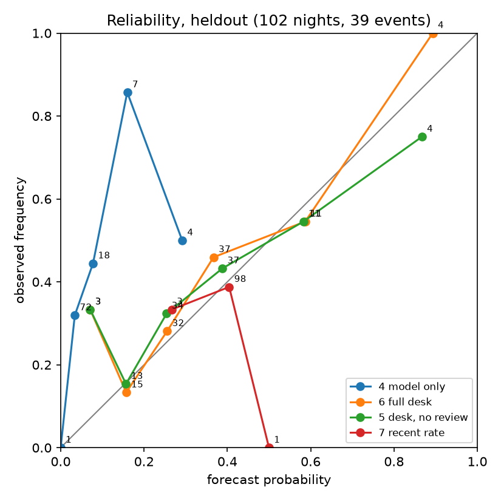
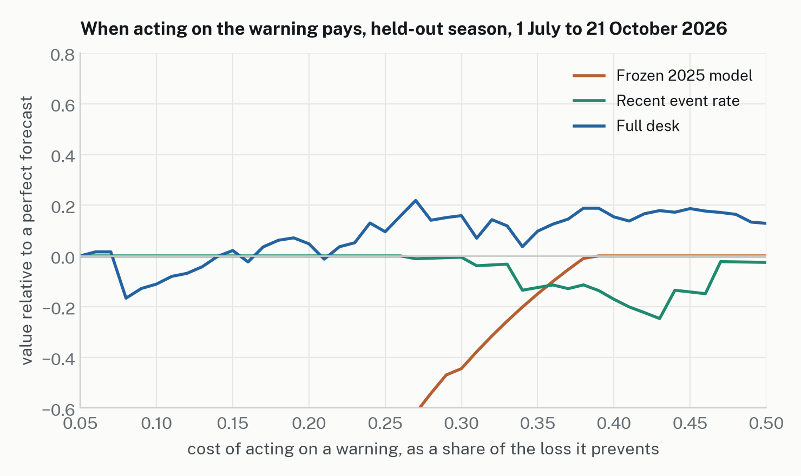

# Results on the heldout period

Generated by `scripts/results.py --split heldout` at commit `3ff6d78`. 102 valid nights, 39 events, base rate 0.382. Event: any hourly SO2 >= 75 ppb at Pahala between 18:00 and 12:00 HST. An hourly mean of 75 ppb does not show that a 15-minute average reached the schools plan's yellow level.

| forecast          |   n |   Brier |   BSS vs clim |   BSS vs persist |     AUC |      t* |    hits |   misses |      FA |     POD |     FAR |     CSI |
|:------------------|----:|--------:|--------------:|-----------------:|--------:|--------:|--------:|---------:|--------:|--------:|--------:|--------:|
| 1 climatology     | 102 |   0.341 |         0.000 |            0.245 | nan     | nan     | nan     |  nan     | nan     | nan     | nan     | nan     |
| 2 persistence     | 101 |   0.455 |        -0.324 |            0.000 | nan     |   1.000 |  16.000 |   23.000 |  23.000 |   0.410 |   0.590 |   0.258 |
| 3 episode rule    | 102 |   0.422 |        -0.237 |            0.087 | nan     |   1.000 |   1.000 |   38.000 |   5.000 |   0.026 |   0.833 |   0.023 |
| 4 model only      | 102 |   0.332 |         0.026 |            0.264 |   0.614 |   0.180 |   3.000 |   36.000 |   2.000 |   0.077 |   0.400 |   0.073 |
| 5 desk, no review | 102 |   0.224 |         0.341 |            0.504 |   0.657 |   0.180 |  37.000 |    2.000 |  51.000 |   0.949 |   0.580 |   0.411 |
| 6 full desk       | 102 |   0.215 |         0.368 |            0.523 |   0.687 |   0.180 |  37.000 |    2.000 |  50.000 |   0.949 |   0.575 |   0.416 |
| 7 recent rate     | 102 |   0.246 |         0.278 |            0.460 |   0.397 |   0.130 |  39.000 |    0.000 |  63.000 |   1.000 |   0.618 |   0.382 |

t* for forecasts 4 to 6 is the frozen value.

## Paired Brier differences (7-day block bootstrap, 90% intervals; 3- and 14-day sensitivity)

| comparison                           |   nights |   difference | 90% CI (7-day blocks)   | 3-day              | 14-day             |   blocks with an event |
|:-------------------------------------|---------:|-------------:|:------------------------|:-------------------|:-------------------|-----------------------:|
| 6 full desk minus 4 model only       |      102 |      -0.1166 | [-0.1571, -0.0801]      | [-0.1561, -0.0799] | [-0.1579, -0.0826] |                     15 |
| 6 full desk minus 7 recent rate      |      102 |      -0.0308 | [-0.0479, -0.0136]      | [-0.0526, -0.0100] | [-0.0510, -0.0101] |                     15 |
| 6 full desk minus 5 desk, no review  |      102 |      -0.0091 | [-0.0188, +0.0011]      | [-0.0204, +0.0015] | [-0.0160, -0.0004] |                     15 |
| 5 desk, no review minus 4 model only |      102 |      -0.1075 | [-0.1550, -0.0644]      | [-0.1500, -0.0681] | [-0.1574, -0.0682] |                     15 |
| 4 model only minus 1 climatology     |      102 |      -0.0088 | [-0.0231, +0.0043]      | [-0.0209, +0.0024] | [-0.0225, +0.0044] |                     15 |
| 7 recent rate minus 1 climatology    |      102 |      -0.0946 | [-0.1437, -0.0488]      | [-0.1417, -0.0479] | [-0.1386, -0.0508] |                     15 |

A negative difference means the first forecast has the lower (better) Brier score. The number of 7-day blocks with at least one event is the effective sample size.

5 desk, no review: 8 nights handed to a human (5 of them events, rate 0.62); scored at the shown probability and never counted as correct.

## Figures

### Reliability bins, 6 full desk

| bin          |   n |   mean_p |   obs_freq |   events |
|:-------------|----:|---------:|-----------:|---------:|
| [0.00, 0.02) |   0 |  nan     |    nan     |        0 |
| [0.02, 0.05) |   0 |  nan     |    nan     |        0 |
| [0.05, 0.10) |   3 |    0.071 |      0.333 |        1 |
| [0.10, 0.20) |  15 |    0.157 |      0.133 |        2 |
| [0.20, 0.30) |  32 |    0.256 |      0.281 |        9 |
| [0.30, 0.50) |  37 |    0.367 |      0.459 |       17 |
| [0.50, 0.70) |  11 |    0.587 |      0.545 |        6 |
| [0.70, 1.00) |   4 |    0.893 |      1.000 |        4 |

### Reliability bins, 4 model only

| bin          |   n |   mean_p |   obs_freq |   events |
|:-------------|----:|---------:|-----------:|---------:|
| [0.00, 0.02) |   1 |    0.000 |      0.000 |        0 |
| [0.02, 0.05) |  72 |    0.034 |      0.319 |       23 |
| [0.05, 0.10) |  18 |    0.078 |      0.444 |        8 |
| [0.10, 0.20) |   7 |    0.160 |      0.857 |        6 |
| [0.20, 0.30) |   4 |    0.292 |      0.500 |        2 |
| [0.30, 0.50) |   0 |  nan     |    nan     |        0 |
| [0.50, 0.70) |   0 |  nan     |    nan     |        0 |
| [0.70, 1.00) |   0 |  nan     |    nan     |        0 |

### Reliability bins, 7 recent rate

| bin          |   n |   mean_p |   obs_freq |   events |
|:-------------|----:|---------:|-----------:|---------:|
| [0.00, 0.02) |   0 |  nan     |    nan     |        0 |
| [0.02, 0.05) |   0 |  nan     |    nan     |        0 |
| [0.05, 0.10) |   0 |  nan     |    nan     |        0 |
| [0.10, 0.20) |   0 |  nan     |    nan     |        0 |
| [0.20, 0.30) |   3 |    0.267 |      0.333 |        1 |
| [0.30, 0.50) |  98 |    0.404 |      0.388 |       38 |
| [0.50, 0.70) |   1 |    0.500 |      0.000 |        0 |
| [0.70, 1.00) |   0 |  nan     |    nan     |        0 |

## What happened inside the desk on the held-out nights

- The review raised at least one flag on 82 of 102 nights (model versus memory-model disagreement 58, regime unseen 33, analog split 30, data gap 5). The DutyLead's gated adjustments were applied on 47 nights in the full desk and 41 in the no-review variant.
- Full desk: base probability (memory model) Brier 0.2199, after adjustments 0.2153. No-review: base 0.2199, after adjustments 0.2244. The same adjustment rule helped after a re-query and hurt without one; that difference is the review loop's measured value on this period, 0.009 Brier, with a 90% interval that touches zero at 7-day blocks and excludes it at 14-day blocks.
- Handovers: the full desk handed over no night (its re-queries resolved every forced case); the no-review variant handed over 8 nights, 5 of them events (rate 0.62 against the period's 0.38). Handed-over nights are scored at the probability shown and never counted as correct.
- Model calls: 102 nights, Lightning evidence summaries passed validation on every night (53 after one retry); the Ultra decision passed on 77 nights (53 after a retry) and fell back to the code's template on 23 nights, which issue the base with no adjustment. The traces record every failure reason.
- Label audit (docs/LABEL_AUDIT_heldout.md): the Department of Health's list has 39 Pāhala exceedance nights in our window, ours has 39, the same 39. Daily maxima agree within 1 ppb on 37; on 14 Aug and 25 Sep 2026 our preliminary AirNow maximum is 16 and 32 ppb above DOH's validated figure (the same hour, revised down in validation). One DOH row (27 Sep, 5 to 6 p.m.) is a daytime exceedance outside the window.
- Effective sample size: 15 seven-day blocks with at least one event.

## Reading

The primary pre-registered claim holds: the full desk has a lower Brier score than the model it was given (−0.117, 90% CI [−0.157, −0.080]). The secondary claim added before the held-out run also holds: it beats the memory-free adaptive baseline (−0.031, [−0.048, −0.014]). Most of the gain comes from the memory model, the pre-registered pipeline refit on the verified nights the desk remembers; the frozen 2025 model is near climatology in this period (BSS +0.03) because the eruption's regime changed. At the frozen threshold t* = 0.18 the full desk warned on 87 of 102 nights (POD 0.95, FAR 0.58, CSI 0.42); a desk that warns this often is a desk for a high-exposure season, and the probability, not the warning, is what the school's designated person should read. The period has 39 events in 102 nights, far from the 2025 training year's 21 in 356; a quieter season would test calibration at the low end, which this period does not.
