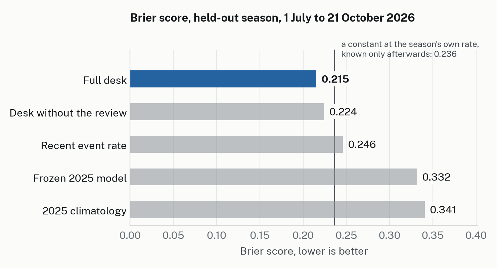
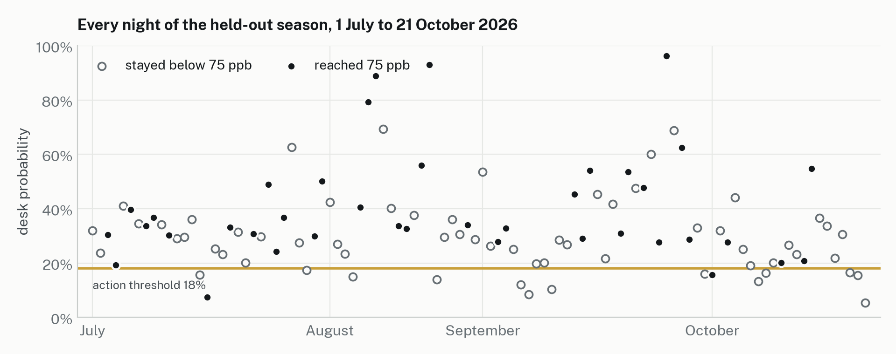

# Results on the held-out period

Generated by `scripts/results.py --split heldout` at commit `3ff6d78`. 102 valid nights, 39 events, base rate 0.382. Event: any hourly SO2 >= 75 ppb at Pahala between 18:00 and 12:00 HST. An hourly mean of 75 ppb does not show that a 15-minute average reached the schools plan's yellow level.

| forecast          |   n |   Brier |   BSS vs clim |   BSS vs persist |     AUC |      t* |    hits |   misses |      FA |     POD |     FAR |     CSI |
|:------------------|----:|--------:|--------------:|-----------------:|--------:|--------:|--------:|---------:|--------:|--------:|--------:|--------:|
| 1 climatology     | 102 |   0.341 |         0.000 |            0.245 | nan     | nan     | nan     |  nan     | nan     | nan     | nan     | nan     |
| 2 persistence     | 101 |   0.455 |        -0.324 |            0.000 | nan     |   1.000 |  16.000 |   23.000 |  23.000 |   0.410 |   0.590 |   0.258 |
| 3 episode rule    | 102 |   0.422 |        -0.237 |            0.087 | nan     |   1.000 |   1.000 |   38.000 |   5.000 |   0.026 |   0.833 |   0.023 |
| 4 model only      | 102 |   0.332 |         0.026 |            0.264 |   0.614 |   0.180 |   3.000 |   36.000 |   2.000 |   0.077 |   0.400 |   0.073 |
| 5 desk, no review | 102 |   0.224 |         0.341 |            0.504 |   0.657 |   0.180 |  37.000 |    2.000 |  51.000 |   0.949 |   0.580 |   0.411 |
| 6 full desk       | 102 |   0.215 |         0.368 |            0.523 |   0.687 |   0.180 |  37.000 |    2.000 |  50.000 |   0.949 |   0.575 |   0.416 |
| 7 recent rate     | 102 |   0.246 |         0.278 |            0.460 |   0.397 |   0.130 |  39.000 |    0.000 |  63.000 |   1.000 |   0.618 |   0.382 |

t* for forecasts 4 to 6 is the frozen value.

For scale, a constant forecast at the held-out base rate (0.382) would score Brier 0.236. Nobody could have issued it, since the rate is known only afterwards. The skill score of +0.37 is measured against the frozen 2025 climatology of 0.059, which is easy to beat in a season where 38% of nights had an event. The comparison to read first is the paired difference against the recent-rate baseline, −0.031 [−0.048, −0.014], together with the 0.021 by which the desk beats the hindsight constant.

## Paired Brier differences (7-day block bootstrap, 90% intervals; 3- and 14-day sensitivity)

| comparison                           |   nights |   difference | 90% CI (7-day blocks)   | 3-day              | 14-day             |   blocks with an event |
|:-------------------------------------|---------:|-------------:|:------------------------|:-------------------|:-------------------|-----------------------:|
| 6 full desk minus 4 model only       |      102 |      -0.1166 | [-0.1571, -0.0801]      | [-0.1561, -0.0799] | [-0.1579, -0.0826] |                     15 |
| 6 full desk minus 7 recent rate      |      102 |      -0.0308 | [-0.0479, -0.0136]      | [-0.0526, -0.0100] | [-0.0510, -0.0101] |                     15 |
| 6 full desk minus 5 desk, no review  |      102 |      -0.0091 | [-0.0188, +0.0011]      | [-0.0204, +0.0015] | [-0.0160, -0.0004] |                     15 |
| 5 desk, no review minus 4 model only |      102 |      -0.1075 | [-0.1550, -0.0644]      | [-0.1500, -0.0681] | [-0.1574, -0.0682] |                     15 |
| 4 model only minus 1 climatology     |      102 |      -0.0088 | [-0.0231, +0.0043]      | [-0.0209, +0.0024] | [-0.0225, +0.0044] |                     15 |
| 7 recent rate minus 1 climatology    |      102 |      -0.0946 | [-0.1437, -0.0488]      | [-0.1417, -0.0479] | [-0.1386, -0.0508] |                     15 |

A negative difference means the first forecast has the lower (better) Brier score. The number of 7-day blocks with at least one event is the effective sample size.

5 desk, no review: 8 nights handed to a human (5 of them events, rate 0.62); scored at the shown probability and never counted as correct.

## Figures

Drawn by `scripts/figures.py` from the per-night CSVs in `results/`.

### Reliability bins, 6 full desk

| bin          |   n |   mean_p |   obs_freq |   events |
|:-------------|----:|---------:|-----------:|---------:|
| [0.00, 0.02) |   0 |  nan     |    nan     |        0 |
| [0.02, 0.05) |   0 |  nan     |    nan     |        0 |
| [0.05, 0.10) |   3 |    0.071 |      0.333 |        1 |
| [0.10, 0.20) |  15 |    0.157 |      0.133 |        2 |
| [0.20, 0.30) |  32 |    0.256 |      0.281 |        9 |
| [0.30, 0.50) |  37 |    0.367 |      0.459 |       17 |
| [0.50, 0.70) |  11 |    0.587 |      0.545 |        6 |
| [0.70, 1.00) |   4 |    0.893 |      1.000 |        4 |

### Reliability bins, 4 model only

| bin          |   n |   mean_p |   obs_freq |   events |
|:-------------|----:|---------:|-----------:|---------:|
| [0.00, 0.02) |   1 |    0.000 |      0.000 |        0 |
| [0.02, 0.05) |  72 |    0.034 |      0.319 |       23 |
| [0.05, 0.10) |  18 |    0.078 |      0.444 |        8 |
| [0.10, 0.20) |   7 |    0.160 |      0.857 |        6 |
| [0.20, 0.30) |   4 |    0.292 |      0.500 |        2 |
| [0.30, 0.50) |   0 |  nan     |    nan     |        0 |
| [0.50, 0.70) |   0 |  nan     |    nan     |        0 |
| [0.70, 1.00) |   0 |  nan     |    nan     |        0 |

### Reliability bins, 7 recent rate

| bin          |   n |   mean_p |   obs_freq |   events |
|:-------------|----:|---------:|-----------:|---------:|
| [0.00, 0.02) |   0 |  nan     |    nan     |        0 |
| [0.02, 0.05) |   0 |  nan     |    nan     |        0 |
| [0.05, 0.10) |   0 |  nan     |    nan     |        0 |
| [0.10, 0.20) |   0 |  nan     |    nan     |        0 |
| [0.20, 0.30) |   3 |    0.267 |      0.333 |        1 |
| [0.30, 0.50) |  98 |    0.404 |      0.388 |       38 |
| [0.50, 0.70) |   1 |    0.500 |      0.000 |        0 |
| [0.70, 1.00) |   0 |  nan     |    nan     |        0 |

## What happened inside the desk on the held-out nights

- The review raised at least one flag on 82 of 102 nights (model versus memory-model disagreement 58, regime unseen 33, analog split 30, data gap 5). The DutyLead's gated adjustments were applied on 47 nights in the full desk and 41 in the no-review variant.
- The base probability (the memory model) scored Brier 0.2199 in both variants. After the duty lead's adjustments the full desk scored 0.2153 and the no-review variant 0.2244. The same adjustment rule helped after a re-query and hurt without one. That gap is what the review loop is worth on this period, and it is small and not established: −0.009 with a 90% interval of [−0.019, +0.001] at 7-day blocks. Only the 14-day sensitivity excludes zero.
- The full desk handed no night to a person; its re-queries resolved every case that would have forced a handover. The no-review variant handed over 8 nights, 5 of which had an event (0.62, against the period's 0.38). Handed-over nights are scored at the probability shown and never counted as correct.
- Lightning's evidence summaries passed the number check on all 102 nights, 53 of them after one retry. Ultra's decision passed on 77 nights, 53 after a retry, and on 23 nights the code's template took over, issuing the base with no adjustment. The traces record why each reply failed.
- The Department of Health's list has 39 Pāhala exceedance nights in our window, and they are the same 39 as ours (docs/LABEL_AUDIT_heldout.md). Daily maxima agree within 1 ppb on 37. On 14 Aug and 25 Sep 2026 our preliminary AirNow maximum is 16 and 32 ppb above DOH's validated figure for the same hour, which validation revised down. One DOH row (27 Sep, 5 to 6 p.m.) is a daytime exceedance outside the window.
- At the frozen t* = 0.18 the full desk said "prepare for yellow or orange" on 87 of 102 held-out nights: 37 hits, 50 false alarms, 2 misses. Forty of those were "prepare for orange" (33 from p ≥ 0.36 and 7 from the analog-maximum clause), and 19 of the 40 had an event. An alert on five nights in six will tire the people who receive it, even in a season with an event every 2.6 nights. The relative value curve above shows for which cost-loss ratios acting on the warning beats always acting or never acting. A user whose costs differ from the threshold's should act on the probability.
- Effective sample size: 15 seven-day blocks with at least one event.

## Reading

The primary pre-registered claim holds: the full desk has a lower Brier score than the model it was given (−0.117, 90% CI [−0.157, −0.080]). The secondary claim, added before the held-out run, also holds: the desk beats the memory-free adaptive baseline (−0.031, [−0.048, −0.014]) and a constant at the hindsight base rate by 0.021. The review loop's contribution is small and not established.

Most of the gain comes from the memory model, the pre-registered pipeline refit on the verified nights the desk remembers. The frozen 2025 model sits near climatology in this period (BSS +0.03) because the eruption's pattern changed.

At the frozen threshold the full desk warned on 87 of 102 nights (POD 0.95, FAR 0.58, CSI 0.42). That rate suits a high-exposure season; in a quieter one the school's designated person should read the probability first. This period had 39 events in 102 nights against the training year's 21 in 356, so calibration at the low end is untested.

## Defect found after scoring

On 24 October, while building the results page, the desk's own G3 stream (recent event rate) turned out not to match forecast 7. The stream queried memory with a cap of 400 records ranked by relevance and took the newest 30 of those; once memory held more than 400 nights, that was not the last 30 nights. On the held-out nights the two differ on every night, by 0.16 on average (G3 Brier 0.273 against forecast 7's 0.246).

What it reached: the value of G3 shown to the duty lead before it chose an adjustment, and the prior the analog rate was shrunk toward. What it did not reach: the base probability, which comes from the memory model and reads up to 2,000 records, and every number in the tables above, where forecast 7 is computed from the labels. The held-out scores stand as the frozen desk produced them; they are not re-run. The live desk uses the corrected stream from 24 October (PREREG change 3), with a regression test.
