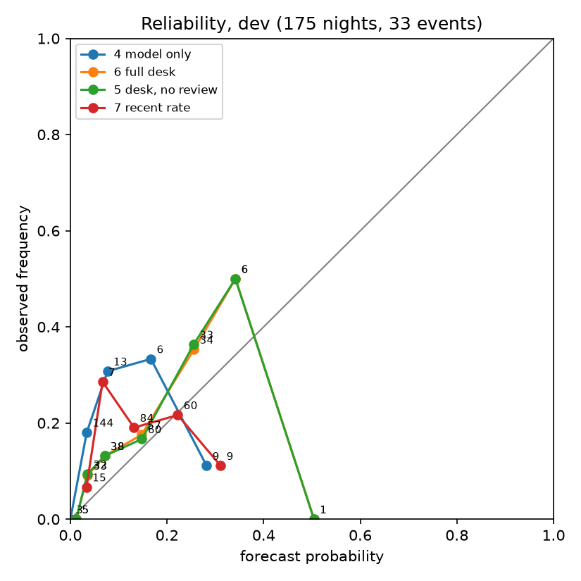
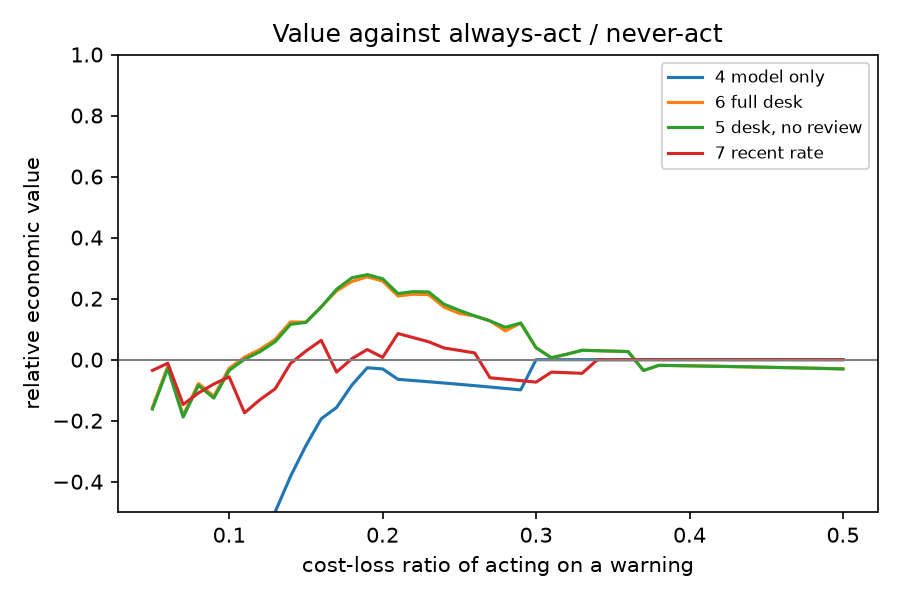

# Results on the dev period

Generated by `scripts/results.py --split dev` at commit `04b4bd1`. 175 valid nights, 33 events, base rate 0.189. Event: any hourly SO2 >= 75 ppb at Pahala between 18:00 and 12:00 HST. An hourly mean of 75 ppb does not show that a 15-minute average reached the schools plan's yellow level.

| forecast          |   n |   Brier |   BSS vs clim |   BSS vs persist |     AUC |      t* |    hits |   misses |      FA |     POD |     FAR |     CSI |
|:------------------|----:|--------:|--------------:|-----------------:|--------:|--------:|--------:|---------:|--------:|--------:|--------:|--------:|
| 1 climatology     | 175 |   0.170 |         0.000 |            0.354 | nan     | nan     | nan     |  nan     | nan     | nan     | nan     | nan     |
| 2 persistence     | 175 |   0.263 |        -0.548 |            0.000 | nan     |   1.000 |   9.000 |   24.000 |  22.000 |   0.273 |   0.710 |   0.164 |
| 3 episode rule    | 175 |   0.274 |        -0.615 |           -0.043 | nan     |   1.000 |   0.000 |   33.000 |  15.000 |   0.000 |   1.000 |   0.000 |
| 4 model only      | 175 |   0.175 |        -0.032 |            0.333 |   0.536 |   0.020 |  33.000 |    0.000 | 139.000 |   1.000 |   0.808 |   0.192 |
| 5 desk, no review | 175 |   0.146 |         0.141 |            0.445 |   0.685 |   0.180 |  17.000 |   16.000 |  31.000 |   0.515 |   0.646 |   0.266 |
| 6 full desk       | 174 |   0.147 |         0.141 |            0.433 |   0.687 |   0.180 |  17.000 |   16.000 |  32.000 |   0.515 |   0.653 |   0.262 |
| 7 recent rate     | 175 |   0.154 |         0.092 |            0.414 |   0.564 |   0.150 |  21.000 |   12.000 |  70.000 |   0.636 |   0.769 |   0.204 |

t* for forecasts 4 to 6 is the CSI-maximising value on this split (PREREG grid 0.01 to 0.60).

## Paired Brier differences (7-day block bootstrap, 90% intervals; 3- and 14-day sensitivity)

| comparison                           |   nights |   difference | 90% CI (7-day blocks)   | 3-day              | 14-day             |   blocks with an event |
|:-------------------------------------|---------:|-------------:|:------------------------|:-------------------|:-------------------|-----------------------:|
| 6 full desk minus 4 model only       |      174 |      -0.0296 | [-0.0521, -0.0099]      | [-0.0459, -0.0148] | [-0.0513, -0.0108] |                     16 |
| 6 full desk minus 7 recent rate      |      174 |      -0.0083 | [-0.0158, -0.0013]      | [-0.0159, -0.0010] | [-0.0179, +0.0005] |                     16 |
| 6 full desk minus 5 desk, no review  |      174 |      +0.0000 | [-0.0003, +0.0004]      | [-0.0003, +0.0004] | [-0.0003, +0.0004] |                     16 |
| 5 desk, no review minus 4 model only |      175 |      -0.0294 | [-0.0517, -0.0098]      | [-0.0456, -0.0147] | [-0.0509, -0.0108] |                     16 |
| 4 model only minus 1 climatology     |      175 |      +0.0055 | [-0.0000, +0.0104]      | [+0.0008, +0.0098] | [+0.0004, +0.0103] |                     16 |
| 7 recent rate minus 1 climatology    |      175 |      -0.0157 | [-0.0339, +0.0015]      | [-0.0297, -0.0029] | [-0.0318, -0.0026] |                     16 |

A negative difference means the first forecast has the lower (better) Brier score. The number of 7-day blocks with at least one event is the effective sample size.

5 desk, no review: 3 nights handed to a human (1 of them events, rate 0.33); scored at the shown probability and never counted as correct.

## Figures

### Reliability bins, 6 full desk

| bin          |   n |   mean_p |   obs_freq |   events |
|:-------------|----:|---------:|-----------:|---------:|
| [0.00, 0.02) |   5 |    0.012 |      0.000 |        0 |
| [0.02, 0.05) |  33 |    0.035 |      0.091 |        3 |
| [0.05, 0.10) |  38 |    0.071 |      0.132 |        5 |
| [0.10, 0.20) |  57 |    0.147 |      0.175 |       10 |
| [0.20, 0.30) |  34 |    0.256 |      0.353 |       12 |
| [0.30, 0.50) |   6 |    0.342 |      0.500 |        3 |
| [0.50, 0.70) |   1 |    0.504 |      0.000 |        0 |
| [0.70, 1.00) |   0 |  nan     |    nan     |        0 |

### Reliability bins, 4 model only

| bin          |   n |   mean_p |   obs_freq |   events |
|:-------------|----:|---------:|-----------:|---------:|
| [0.00, 0.02) |   3 |    0.000 |      0.000 |        0 |
| [0.02, 0.05) | 144 |    0.034 |      0.181 |       26 |
| [0.05, 0.10) |  13 |    0.077 |      0.308 |        4 |
| [0.10, 0.20) |   6 |    0.167 |      0.333 |        2 |
| [0.20, 0.30) |   9 |    0.282 |      0.111 |        1 |
| [0.30, 0.50) |   0 |  nan     |    nan     |        0 |
| [0.50, 0.70) |   0 |  nan     |    nan     |        0 |
| [0.70, 1.00) |   0 |  nan     |    nan     |        0 |

### Reliability bins, 7 recent rate

| bin          |   n |   mean_p |   obs_freq |   events |
|:-------------|----:|---------:|-----------:|---------:|
| [0.00, 0.02) |   0 |  nan     |    nan     |        0 |
| [0.02, 0.05) |  15 |    0.033 |      0.067 |        1 |
| [0.05, 0.10) |   7 |    0.067 |      0.286 |        2 |
| [0.10, 0.20) |  84 |    0.132 |      0.190 |       16 |
| [0.20, 0.30) |  60 |    0.222 |      0.217 |       13 |
| [0.30, 0.50) |   9 |    0.311 |      0.111 |        1 |
| [0.50, 0.70) |   0 |  nan     |    nan     |        0 |
| [0.70, 1.00) |   0 |  nan     |    nan     |        0 |
